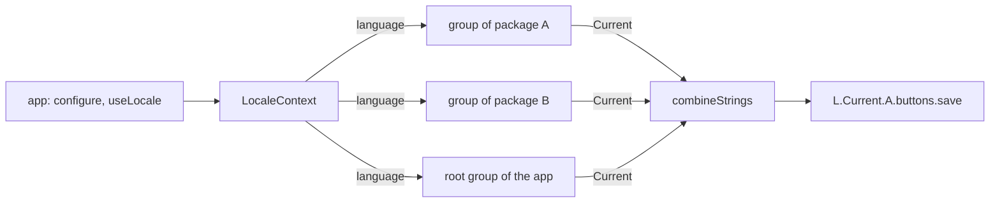

# Localization

Groups of localized strings that follow one shared current language.
A package defines a group with its own languages, and an app picks the language, patches strings and combines the groups of all its packages.

## Concept

The parts:
- a group, `LocalizedStrings`, is a default language with its strings and optional other languages; code reads it as `Group.Current.<key>`
- a context, `LocaleContext`, holds the current language as a plain string, or none; every group follows one context
- `combineStrings` joins groups into one object, so an app reads every package's strings from one place

A context keeps no list of languages, since it cannot know the languages of the groups that read it.



## Usage

A package declares its group, and the app wires the context once at startup.

```ts
// a package
export const ShopStrings = new LocalizedStrings('en', {
    buttons: { save: 'Save', cancel: 'Cancel' },
    count: (n: number) => `${n} items`,
}, {
    others: {
        es: {
            buttons: { save: 'Guardar', cancel: 'Cancelar' },
            count: (n: number) => `${n} artículos`,
        },
    },
});

// an app, at startup
const AppStrings = new LocalizedStrings('en', { Common: { ok: 'OK' } });

LocaleContext.Shared.configure({ locale: 'es-MX' });
ShopStrings.patch({ en: { buttons: { cancel: 'Dismiss' } } });

export const L = combineStrings(AppStrings, { Shop: ShopStrings });
L.Current.Shop.buttons.save;
```

## Rules

The context:
- `LocaleContext.Shared` is the context a group follows unless it is given another, so a group in a package needs no wiring.
- A context starts with no language, so every group shows its default until an app picks one.
- `configure()` comes before the first box exists, and throws afterwards, so a late storage provider is never silently ignored.
  A read of `Locale`, a `useLocale()` call and a group's first use each create a box.
  An app sets its first language through `configure({ locale })` and switches it later with `useLocale()`.
- A context creates its boxes, and its groups' boxes, from the configured storage provider, and plain boxes when none is set.
  A provider whose writes re-run readers synchronously needs `transaction`, so that a reader never sees a half-written change.
- A context is a `Loggable`: an app sets one logger with `LocaleContext.Shared.setLogger()`, at any time, since a logger is not a box.

Language resolution:
- A group matches the context's language against its own languages with `resolveLocale`, which is also exported for other formatting.
- The match is exact first, ignoring case and treating `-` and `_` alike, then each shorter prefix, longest first, then the default.
- A requested base language never resolves to a regional variant: `en` does not give `en-US`.

Other languages:
- A language other than the default is its strings, or a loader that returns them.
  The default stays inline: it gives the shape, so `Current` is always defined.
- Every other language has the full shape of the default, so a new default string cannot go untranslated unnoticed.
- A loader runs when a read of `Current` or `Locale` needs its language, or on `preload()`, and never on a switch alone.
- A loader must resolve to a plain object of strings; any other result counts as a failed load.
- Extra keys are checked only in an inline language object, so a language declared as a separate constant needs `satisfies` against the default's type.

Switching:
- A group shows its default until the language it resolves to has loaded, and groups switch at their own moments.
- A consistent switch awaits `preload()` of every group, then calls `useLocale()`.
- A subclass overrides `selectShownLocale()` to show another loaded language while one loads.
- A group has no change event and never subscribes to its context.
  Code that must react to a switch subscribes to `LocaleContext.localeChanged`, awaits `preload()`, then reads `Current`.

Failed loads:
- A failure is logged to the group's own logger, or to the context's logger when the group has none.
  A group that has neither fails silently, so an app sets the context's logger.
- By default a group keeps showing its default language after a failure, and a read does not retry.
- `preload()` retries, and rejects with an `Error` that names the language and carries the loader's error as `cause`.

Patches:
- A patch is deep-partial, per language, and applies in call order, so a later one wins.
  `patch()` returns a function that removes it.
- Plain objects merge recursively, and strings, functions and arrays replace the value whole.
- A member typed as a mix of primitives and objects takes only a complete value.
- A patch for a language that has not loaded yet applies once it loads.

Combining:
- The root group's keys sit at the top level, and each part sits under the key it is given.
- A part key that the root already has is a type error, unless the root has an index signature.
- The combined object has no `patch` and no `Locale`: an app patches each group, and each group resolves its own language.
- The combined `Current` stays the same object until a part's `Current` changes.

## Migrating from `LocalizationManager`

`LocalizationManager` is deprecated, and stays until its consumers have moved.

Why move:
- each instance owns its current language, so groups in different packages cannot follow one language
- an app made it reactive by wrapping the whole instance, which only works in that app

To move a manager to a group:
1. Declare the default language inline and the others as `others`, each with the full shape.
2. Switch the language on the context, with `LocaleContext.Shared.useLocale()`, which is synchronous.
3. Replace `localeUpdated` and `synchronizeLocale` with `LocaleContext.localeChanged`, `preload()` and a read of `Current`.
4. Move reactivity from wrapping the instance to the storage provider: pass it to `LocaleContext.Shared.configure({ storage })`.
   `@zajno/common-mobx` exports `mobxStorageProvider` for that.

## Where to start in the code

- `LocaleContext.ts`: the current language, the storage provider and the logger.
- `LocalizedStrings.ts`: a group, its languages, loading and patches.
- `combineStrings.ts`: joining groups.
- `resolveLocale.ts`: the language match.
- `abstractions.ts`: `ILocalization` and the patch type.
